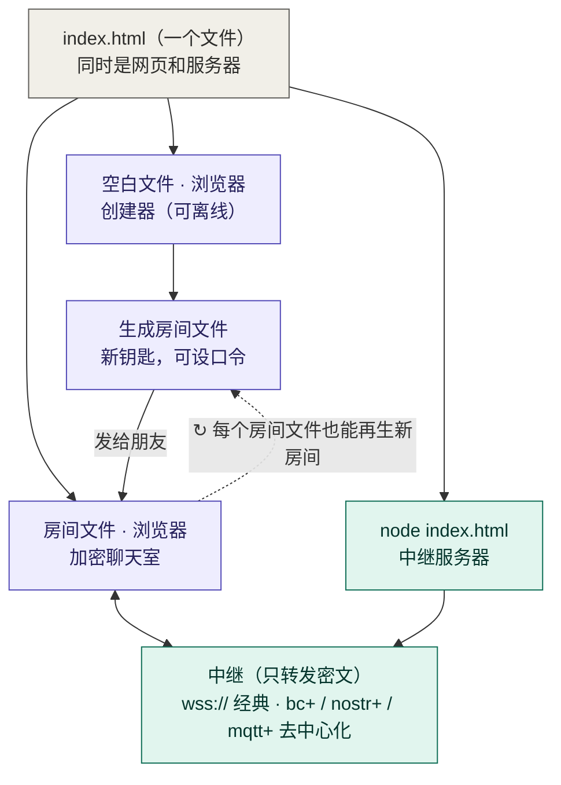

# HTML Room

**一个不用注册、不用装软件的加密聊天室。** 打开网页点一下，就能建好一个房间，把文件或链接发给朋友，大家打开就能聊天。

[](https://github.com/Freecode100Year/htmlroom/actions/workflows/test.yml)
[](https://github.com/Freecode100Year/htmlroom/actions/workflows/pages.yml)
[](LICENSE)

👉 **[马上创建房间](https://freecode100year.github.io/htmlroom/)**　（也可使用 [Vercel 入口](https://htmlroom6.vercel.app/) 或 [备用入口](https://chat.nya.je/)）

---

## 它是什么？

可以把它想象成一个**带锁的临时小房间**：

- 🏠 **房间**：你在网页上点「创建房间」，就得到一个只属于你们的聊天室。
- 🔑 **钥匙**：房间的钥匙就藏在你拿到的**文件**或**链接**里。谁拿到它，谁就能进门。
- 🔒 **上锁的信**：你们发的每句话都会先“锁”起来再送出去。负责传话的服务器只能看到一堆乱码，看不到内容。
- 💨 **说完就散**：本项目不会持久保存聊天记录。关掉网页，这个页面里的聊天内容就没了；对方仍可复制或截图。

### 一张图看懂

整个项目就是一个 `index.html`：怎么打开它，它就扮演什么角色。



- **浏览器打开空白文件**：创建器，断网也能生成房间文件。
- **浏览器打开房间文件**：加密聊天室；房间文件里也带着创建器，可以继续生成新房间。
- **`node index.html`**：中继服务器；空白文件运行时还会提供创建页面，房间文件运行时不公开自己。
- 聊天要经过中继，中继只看得到密文。

## 三步开始聊天

**第 1 步：创建房间**
打开 [房间生成器](https://freecode100year.github.io/htmlroom/)，直接点「创建房间」就行，其他设置都不用改。
如果想多一层保险，可以点「随机生成口令」设个密码（相当于门上再加一把锁）。

**第 2 步：发给朋友**
点「创建房间」后，你可以：

- 下载一个叫 `index.html` 的文件，发给朋友；**或者**
- 复制房间链接，发给朋友。

如果设了密码，**请用另一种方式**把密码告诉朋友（比如链接用微信发，密码打电话说）。

**第 3 步：核对安全码，开始聊天**
大家进入房间后，屏幕上会显示一个**安全码**。请用电话或当面互相念一遍，确认一致，有助于发现密钥被调换；仍需通过这个独立渠道确认对方身份。

> 💡 每点一次「创建房间」都会生成一个**全新的**房间，就算密码一样，也进不了以前的房间。

## 不联网也能创建：一个文件就是整个网站

- **每个房间文件都能再生一个新房间。** 打开任意 `index.html`，展开「创建一个新房间」，就能生成钥匙不同、可设新口令的新房间文件。全程在文件里完成，**不需要联网，也不依赖任何网站**；生成的文件和官方构建逐字节一致。
- **离线创建器。** 网站本身就是一个不带房间的 `index.html`。在网站底部点「下载离线版」保存下来，以后断网也能用它创建房间。
- 只有聊天时需要连上中继。

## 房间文件同时是服务器

同一个 `index.html`，用浏览器打开是聊天室；装了 [Node.js](https://nodejs.org/)（18 或更新）的电脑上运行它，就是中继服务器，什么都不用安装：

```sh
node index.html            # 本机中继 + 创建页面 http://127.0.0.1:8080/
node index.html --tunnel   # 再加一个免费公网地址（需要 cloudflared）
node index.html --help     # 全部选项
```

- 空白创建器运行时，同时提供创建页面和中继，**一个文件就是一个完整的网站**。
- 房间文件运行时只当中继，**不会把自己当网页公开**，以免泄露房间钥匙。
- 支持经典房间（`wss://…`）和去中心化房间（`bc+wss://…/bc/`）。其他设备需要 `wss://`：加 `--tunnel`，或用 `--tls-cert`/`--tls-key`。
- 如果提示 `Unknown file extension ".html"`，说明文件所在目录上层有声明 `"type": "module"` 的 package.json：换个目录，或复制成 `relay.cjs` 再运行 `node relay.cjs`。
- 只运行你信任或核验过（`node scripts/verify-room-file.mjs 文件`）的文件：运行等于在电脑上执行文件里的代码。

## 能做什么，不能做什么

| ✅ 可以 | ❌ 不可以 |
| --- | --- |
| 发文字消息 | 发图片、文件、语音 |
| 一个房间最多 **25 人** | 保存聊天记录 |
| 每条消息最多 **500 字** | 不联网使用（聊天时必须有网） |
| 断网后自动重连 | 找回已关闭页面里的消息 |

创建房间时可按优先级填写 **1–3 个经典中继**（以逗号或空格分隔），或改用下文的[去中心化中继](#去中心化房间不依赖任何一台服务器)。首选不可用时会尝试备用，并每 60 秒探测首选是否恢复。页面显示当前中继和在线人数；连到不同中继的成员暂时无法互通，切换后请重新核对安全码。所有成员须使用同一份房间配置。

**在房间文件里直接填自己的中继：** 新创建的房间文件默认允许自定义中继。打开文件后，进房间前可以把「中继服务器」改成任意 `wss://` 地址（也可以填去中心化中继），只对这次打开有效、不改动文件。大家要连同一个中继才能互相看到消息；去中心化中继只要有一个相同即可。创建时在「中继服务器（一般不用改）」里取消勾选「允许在房间文件里自定义中继」，文件就只能连列出的中继，更严格。

**想改用自己搭的中继？** 打开房间文件，展开「换一个中继服务器」，填入自己的 `wss://` 地址即可生成同一房间的新文件（密钥、口令不变，无需口令）；也可在生成器页面的「已经有房间文件？换一个中继服务器」中转换旧文件。把新文件发给所有成员后，大家就在你的中继上聊天，并重新核对安全码。详见 [更换中继](docs/DEVELOPER.md#更换中继迁移到自建中继)。

多中继配置使用新版房间格式，旧文件/链接需重新生成。网页房间链接只支持站点预先允许的中继，其他组合请使用下载的房间文件。配置静态网页的多个中继见 [开发说明](docs/DEVELOPER.md#多中继房间)。

## 常见问题

**微信 / QQ / iPhone 里点开文件没反应怎么办？**
这些 App 的“预览”功能经常无法运行聊天室。请**复制房间链接**，粘贴到 Safari、Chrome 等浏览器的地址栏里打开。
（目前还没有在 iPhone、安卓手机、微信、QQ 上做过完整的实机测试。）

**这个文件 / 链接可以随便转发吗？**
**不可以。** 文件和链接就是房间钥匙，转给谁，谁就能进来。请只发给要聊天的人。

**设了密码就绝对安全了吗？**
密码越长越乱越好。像 `1234` 这样的短密码，别人拿到文件后可以慢慢猜出来，所以建议使用「随机生成」的密码。

**服务器能看到什么？**
看不到聊天内容。但它能知道「有人在某个时间连进了某个房间」以及传了多少数据，也可能因为故障导致消息发不出去。

**需要注意什么？**

- 如果你的手机或电脑本身中了病毒，任何加密都保护不了你。
- 本项目还没有经过第三方专业机构的安全审计。
- 想要更放心，就一定要**核对安全码**。

## 去中心化房间：不依赖任何一台服务器

创建房间时，中继除了填经典的 `wss://…`，还可以填以下三种去中心化中继，最多 5 个，可以混用：

| 写法 | 是什么 | 谁来提供 |
| --- | --- | --- |
| `bc+wss://主机/bc/` | 只负责转发的中继 | 本项目任何部署（Cloudflare、Docker、一键安装），或下面的单文件中继；任意「同一路径收到的消息转发给其他连接」的 WebSocket 服务器都兼容 |
| `nostr+wss://…` | Nostr 中继 | 公共 Nostr 网络中的中继，或自建 |
| `mqtt+wss://…/mqtt` | MQTT 代理（WebSocket） | mosquitto、EMQX 等，路由器、树莓派都能跑 |

消息**同时发往全部中继**并自动去重：只要有一个还通，大家就能聊天，也不会出现连到不同中继的人互相看不到的情况。成员编号、在线名单都由各成员自己协商，中继只负责转发看不懂的密文；没有房间密钥的人发来的数据会被直接丢弃。旧房间文件可以用「换一个中继服务器」直接改成去中心化房间，密钥和口令不变。

> 代价：没有中继替你挡住乱发数据的人（他们只能浪费流量，解不开也伪造不了消息）；公共 Nostr/MQTT 中继能看到你的 IP 和收发时间，规范要求不保存临时消息，但无法保证。成员变化后请重新核对安全码。部分公共 Nostr 中继要求登录或付费，会在页面上提示被拒绝，换一个即可。

### 一条命令开一个中继：不要域名、不要公网 IP、不要 root

```sh
curl -fsSL https://raw.githubusercontent.com/Freecode100Year/htmlroom/main/scripts/relay-quickstart.sh | sh -s -- --tunnel
```

脚本下载对应平台的单文件中继（校验 SHA-256），并通过 Cloudflare 免费临时隧道得到公网地址，最后打印一行 `bc+wss://xxxx.trycloudflare.com/bc/`，把它填进房间即可。支持 Linux、macOS、FreeBSD、WSL、Termux 和 OpenWrt。Windows 可从 [Releases](https://github.com/Freecode100Year/htmlroom/releases) 下载 `htmlroom-relay-windows-amd64.exe`，安装 [cloudflared](https://developers.cloudflare.com/cloudflare-one/connections/connect-networks/downloads/) 后运行 `htmlroom-relay-windows-amd64.exe -tunnel`。临时隧道地址每次启动都会变化；长期使用请配域名和 HTTPS，详见 [单文件中继](docs/DEVELOPER.md#单文件中继go)。

## 部署自己的聊天室

### Cloudflare：前端和中继一起部署（推荐）

[](https://deploy.workers.cloudflare.com/?url=https://github.com/Freecode100Year/htmlroom)

登录 Cloudflare，按页面提示创建仓库并部署。前端和 Durable Objects 中继在同一个 Worker 上，部署后打开分配的 `workers.dev` 地址即可创建房间，无需另配 Origin。

仓库须公开。实测按钮可跳转至 Cloudflare 控制台，但当前测试环境被其验证页拦截（403），账户授权及 `JOIN_LIMIT` 绑定兼容性尚未完成线上验证；如果页面不支持该绑定，请在创建的仓库中移除 `wrangler.jsonc` 的 `ratelimits` 项后重新部署。代码已支持缺少该绑定时每个 Worker 实例仅记录一次不含请求信息的警告并跳过加入限流，房间人数和消息大小限制仍生效。详见 [Cloudflare 部署说明](docs/DEVELOPER.md#cloudflare-workers)。

### 有自己的服务器？一条命令搭建私人中继

准备一台 Debian/Ubuntu 服务器（x86_64 或 arm64）、root 或 sudo 权限，以及一个**已解析到服务器公网地址的域名**。域名的 A/AAAA 记录都须指向本机，开放 TCP 80/443。

```sh
curl -fsSL https://raw.githubusercontent.com/Freecode100Year/htmlroom/main/scripts/install.sh | sh -s -- --domain relay.example.com
```

将 `relay.example.com` 换成自己的域名；省略 `--domain` 可按提示输入。脚本检查 DNS、按需安装 Docker，通过 Caddy 自动申请 HTTPS 证书，最后给出网页地址 `https://relay.example.com/` 和中继地址 `wss://relay.example.com`。默认从 GHCR 拉取镜像，安装目录为 `/opt/htmlroom`；重复执行会更新配置并启动服务，不删除证书。

首次镜像尚未发布、未开放匿名拉取，或服务器无法访问 GHCR 时，在命令末尾加 `--build` 从源码构建。仓库维护者可在合并后手动运行 **Publish relay image** 工作流发布首次镜像；需确认包的公开可见性及匿名拉取成功。后续每次推送 tag 会自动发布 amd64/arm64 镜像。源码构建仍需能访问 GitHub、Docker Hub 和 npm。

卸载只需重新运行命令，把 `--domain relay.example.com` 换成 `--uninstall`；只移除有安装标记的本项目容器和生成配置，保留证书卷、源码和目录中的自有文件。详细的预检、更新与本机测试见 [服务器一键安装](docs/DEVELOPER.md#服务器一键安装ubuntudebian)。

### Vercel：仅部署前端

[](https://vercel.com/new/clone?repository-url=https%3A%2F%2Fgithub.com%2FFreecode100Year%2Fhtmlroom&env=HR_PAGES_RELAY&envDescription=WebSocket%20relay%20origin%20such%20as%20wss%3A%2F%2Frelay.example.com&envLink=https%3A%2F%2Fgithub.com%2FFreecode100Year%2Fhtmlroom%2Fblob%2Fmain%2Fdocs%2FDEVELOPER.md)

部署时填写 `HR_PAGES_RELAY`（例如 `wss://你的中继域名`）。这不会部署聊天中继；请先准备 Cloudflare 或 Node 中继，并在中继的 `HR_ALLOWED_ORIGINS` 中加入 Vercel 网站的精确 HTTPS 来源。使用 `chat.nya.je` 也需要其运营者放行你的域名，不能保证复制前端后就能连接。详见 [Vercel 部署说明](docs/DEVELOPER.md#部署前端到-vercel)。

### 部署支持与验证结果

已提供 Cloudflare 完整部署入口、Vercel 静态前端配置，以及 Ubuntu/Debian 的 Docker + Caddy 一键安装脚本。安装脚本支持 POSIX sh、`--check` 格式预检、DNS 校验、重复运行和 `--uninstall`，拒绝操作无本项目安装标记的已有目录，并通过 HTTPS `/healthz` 验证中继。

本地验证：38 项项目测试通过（默认跳过的 9 项 Worker 探针另行运行，全部通过），静态前端、网页/文件互通及双中继故障切换浏览器测试、构建检查和 Worker 打包检查通过。Docker 镜像构建与 Compose/Caddy 配置也已在部署功能加入时通过检查。这些检查不代表已完成公网服务器安装或云端部署；Cloudflare 按钮的登录后绑定兼容性仍待验证。

## 给开发者

[](https://deploy.workers.cloudflare.com/?url=https://github.com/Freecode100Year/htmlroom)

按钮将前端和中继部署到同一个 Worker。完成后在 Cloudflare 控制台的 **Workers & Pages** 中打开自己的项目，点击 **Visit / 访问** 或复制 `https://项目名.账户子域.workers.dev` 地址；打开这个网址即可创建房间，无需设置 `HR_ALLOWED_ORIGINS`。部署步骤见[开发文档](docs/DEVELOPER.md#cloudflare-workers)，域名隐私与验证方法见 [ECH 说明](docs/ECH.md)。

想在自己电脑上运行、搭建自己的服务器，或者了解技术细节？请看：

- [开发与部署说明](docs/DEVELOPER.md)：本地运行、GitHub Pages、Node.js / Docker / Cloudflare Workers 中继、测试命令
- [安全模型](docs/html-room/security-model.md) · [协议说明](docs/html-room/protocol.md) · [验证记录](docs/VALIDATION.md)

快速体验（需要 Node.js 22 或更高版本）：

```sh
git clone https://github.com/Freecode100Year/htmlroom.git
cd htmlroom
npm ci
npm start
```

然后在浏览器打开 <http://localhost:8080/>。

## 来源与许可证

本项目从 [private-talk](https://github.com/Freecode100Year/private-talk) 中独立出来，详见 [来源说明](docs/PROVENANCE.md)。

采用 [MIT 许可证](LICENSE)，保留原作者版权及 [第三方声明](THIRD_PARTY_NOTICES.md)。
