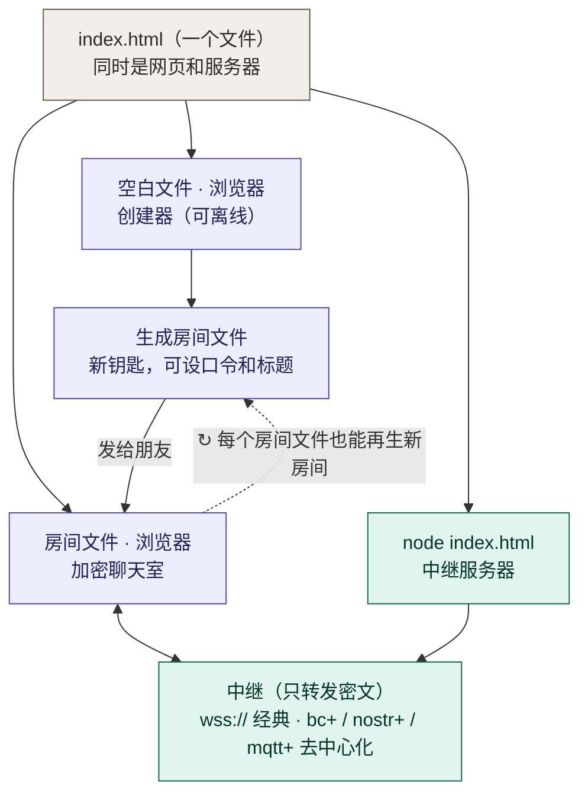

# HTML Room

**一个文件就是一个加密聊天室。** 不用注册、不用装 App：打开网页点一下，得到一个 `index.html`，发给朋友，大家打开就能聊。断网也能创建房间；装了 Node.js 的电脑上运行同一个文件，它就是服务器。

[](https://github.com/Freecode100Year/htmlroom/actions/workflows/test.yml)
[](https://github.com/Freecode100Year/htmlroom/actions/workflows/pages.yml)
[](https://github.com/Freecode100Year/htmlroom/releases)
[](LICENSE)

👉 **[马上创建房间](https://freecode100year.github.io/htmlroom/)**（也可使用 [Vercel 入口](https://htmlroom6.vercel.app/) 或 [备用入口](https://chat.nya.je/)）

## Cloudflare 在线入口

- **网站**：[https://hr50.freedom8964.com/](https://hr50.freedom8964.com/)
- **WSS 中继源**：`wss://hr50.freedom8964.com`

网站与中继部署在同一个 Cloudflare Worker，网页默认使用上述中继源。将中继源填入「中继服务器」即可使用；客户端会自动添加房间路径 `/hr/<roomId>`。

此实例的部署配置为 `wrangler.hr50.jsonc`，更新命令：`npm ci && npm run build && npx wrangler deploy --config wrangler.hr50.jsonc`。

---

## 一个文件，三种身份

整个项目就是一个 `index.html`：怎么打开它，它就扮演什么角色。



- **浏览器打开空白文件**：创建器。网站本身就是它，底部可以「下载离线版」，以后断网也能创建房间。
- **浏览器打开房间文件**：加密聊天室。文件里还带着创建器，可以离线生成钥匙不同的新房间。
- **`node index.html`**：中继服务器，零依赖。空白文件运行时还会提供创建页面；房间文件运行时不公开自己，以免泄露钥匙。
- 聊天时消息经过中继，中继只看得到密文。

## 三步开始聊天

**1. 创建房间**　打开[创建页面](https://freecode100year.github.io/htmlroom/)，直接点「创建房间」。可选：
- **房间标题**：最多 60 字，显示在浏览器标签页和页面顶部；不填就是「聚众加密聊天房间」。
- **口令**：相当于门上再加一把锁。建议点「随机生成口令」：会生成一串好念好抄的口令（如 `K7QM-3XRP-9DTA-HWVE-N4BC`），直接显示出来，点「复制口令」即可复制；房间建好后口令仍会显示在结果里。

**2. 发给朋友**　下载 `index.html` 发给朋友，或复制房间链接。设了口令的话，**口令请换一种方式告诉对方**（比如文件用微信发，口令打电话说）。

**3. 核对安全码**　进房后屏幕上会显示一串安全码。请用电话或当面互相念一遍，一致才说明没有人冒充。有人进出、换中继之后，再核对一次。

> 💡 每次「创建房间」都会生成一个**全新的**房间。就算口令一样，也进不了以前的房间。

## 功能一览

| 功能 | 说明 |
| --- | --- |
| 端到端加密 | 每对成员之间做 ECDH + ML-KEM-768 混合密钥交换（抗「先存后解」），每条消息都签名；中继看不到内容，也伪造不了消息 |
| 安全码 | 由全体成员的签名身份生成，用来发现密钥被调换 |
| 离线创建 | 空白文件和每个房间文件都能在断网时生成新房间，结果与官方构建逐字节一致 |
| 文件即服务器 | `node index.html` 直接运行中继，不用安装任何东西 |
| 房间标题 | 创建时可起名；持有文件的人以后可以改名，房间和口令不变 |
| 自定义中继 | 进房前可以改填任意 `wss://` 中继（只对这次打开有效）；也能生成换了中继的新文件发给大家 |
| 去中心化中继 | 可以用任意转发服务器、Nostr 中继、MQTT 代理，消息同时走多个中继 |
| 一个房间最多 50 人 | 写死在代码里，所有中继和页面执行同一个数 |
| 不留记录 | 不保存聊天记录；关掉页面，聊天内容就没了（对方仍可截图） |

## 中继：消息怎么送过去

聊天需要中继帮忙转发密文。中继有两类，**不能混用**：

| 类型 | 写法 | 特点 |
| --- | --- | --- |
| 经典中继 | `wss://relay.example.com`（1–3 个） | 由中继分配成员号、限流和把门；坏了按顺序自动换下一个，连到不同中继的成员暂时看不到彼此 |
| 去中心化中继 | `bc+wss://主机/bc/`、`nostr+wss://…`、`mqtt+wss://…/mqtt`（1–5 个） | 中继只转发，成员自己协商编号和名单；消息同时走全部中继，只要有一个还通就能聊 |

- **在文件里临时换中继**：新创建的房间文件默认允许自定义中继。进房前把「中继服务器」改成自己的地址即可，不改动文件。创建时取消勾选「允许在房间文件里自定义中继」，文件就只能连列出的中继，更严格。
- **让所有人一起换**：打开房间文件，展开「生成新文件：换中继或改标题」，生成同一房间的新文件发给大家。旧文件也可以在创建页的「已经有房间文件？换一个中继服务器」里转换。
- **去中心化房间的代价**：没有中继替你挡住乱发数据的人，他们解不开也伪造不了消息，但能浪费流量。公共 Nostr/MQTT 中继能看到 IP 和收发时间。去中心化中继只能广播，人多时流量增长很快，建议控制在 30 人左右；人多的房间用经典中继。

## 自己当中继：从最简单到最完整

**① 用房间文件本身**（需要 [Node.js](https://nodejs.org/) 18+）

```sh
node index.html            # 本机中继 + 创建页面 http://127.0.0.1:8080/
node index.html --tunnel   # 再加一个免费公网地址（需要 cloudflared）
node index.html --help     # 全部选项（端口、TLS 证书、允许的来源……）
```

启动后会打印可以填进房间的中继地址。其他设备连接需要 `wss://`：加 `--tunnel`，或用 `--tls-cert` / `--tls-key`。

**② 一条命令开单文件中继**：不要域名、不要公网 IP、不要 root

```sh
curl -fsSL https://raw.githubusercontent.com/Freecode100Year/htmlroom/main/scripts/relay-quickstart.sh | sh -s -- --tunnel
```

脚本下载对应平台的单文件中继（强制校验 SHA-256），并通过 Cloudflare 免费临时隧道得到公网地址，最后打印一行 `bc+wss://xxxx.trycloudflare.com/bc/`，填进房间即可。支持 Linux、macOS、FreeBSD、WSL、Termux 和 OpenWrt。Windows 请从 [Releases](https://github.com/Freecode100Year/htmlroom/releases) 下载 `htmlroom-relay-windows-amd64.exe`，装好 [cloudflared](https://developers.cloudflare.com/cloudflare-one/connections/connect-networks/downloads/) 后运行 `htmlroom-relay-windows-amd64.exe -tunnel`。临时隧道地址每次启动都会变；长期使用请配域名，见[单文件中继](docs/DEVELOPER.md#单文件中继go)。

**③ 自己的服务器一键安装**：Debian/Ubuntu，需要一个已解析到本机的域名，开放 80/443

```sh
curl -fsSL https://raw.githubusercontent.com/Freecode100Year/htmlroom/main/scripts/install.sh | sh -s -- --domain relay.example.com
```

脚本检查 DNS、按需安装 Docker，用 Caddy 自动申请 HTTPS 证书，最后给出网页地址 `https://relay.example.com/` 和中继地址 `wss://relay.example.com`。重复运行即更新，`--uninstall` 卸载（保留证书和你自己的文件）。详见[服务器一键安装](docs/DEVELOPER.md#服务器一键安装ubuntudebian)。

**④ Cloudflare：网站和中继一起部署**

[](https://deploy.workers.cloudflare.com/?url=https://github.com/Freecode100Year/htmlroom)

网站和 Durable Objects 中继在同一个 Worker 上，部署后打开分配的 `workers.dev` 地址即可使用。仓库须公开。如果控制台不支持 `JOIN_LIMIT` 绑定，删掉 `wrangler.jsonc` 里的 `ratelimits` 后重新部署即可，人数和消息限制仍然生效。详见 [Cloudflare 部署说明](docs/DEVELOPER.md#cloudflare-workers)。

**⑤ Vercel：只部署网站**

[](https://vercel.com/new/clone?repository-url=https%3A%2F%2Fgithub.com%2FFreecode100Year%2Fhtmlroom&env=HR_PAGES_RELAY&envDescription=WebSocket%20relay%20origin%20such%20as%20wss%3A%2F%2Frelay.example.com&envLink=https%3A%2F%2Fgithub.com%2FFreecode100Year%2Fhtmlroom%2Fblob%2Fmain%2Fdocs%2FDEVELOPER.md)

部署时填写 `HR_PAGES_RELAY`（例如 `wss://你的中继域名`），作为创建页的默认中继。这一步不会部署中继：要从网站链接进经典中继的房间，还需在中继的 `HR_ALLOWED_ORIGINS` 里加入网站的 HTTPS 来源。从文件打开不受影响。详见 [Vercel 部署说明](docs/DEVELOPER.md#部署前端到-vercel)。

## 能做什么，不能做什么

| ✅ 可以 | ❌ 不可以 |
| --- | --- |
| 发文字消息，每条最多 **500 字** | 发图片、文件、语音 |
| 一个房间最多 **50 人** | 保存或找回聊天记录 |
| 断线后自动重连，消息有送达回执 | 不联网聊天（创建房间可以离线） |
| 每人约 6 秒发一条（防刷屏），多发的自动排队 | 防止对方截图或转述 |

## 安全与隐私

- **中继能看到什么**：看不到聊天内容；能看到谁在什么时间连进来、传了多少数据，也可能故意丢弃或延迟消息（回执会显示「未确认」）。
- **文件和链接就是钥匙**：转给谁，谁就能进来。口令要足够长；像 `1234` 这样的短口令，别人拿到文件后可以离线慢慢猜。
- **一定要核对安全码**：这是发现冒充和密钥被调换的唯一办法。
- **核验文件**：`node scripts/verify-room-file.mjs index.html` 会把整个文件（包括内嵌的服务器代码）与可复现构建逐字节比对。用 `node index.html` 运行文件，等于在电脑上执行其中的代码，请只运行你信任或核验过的文件。
- **局限**：设备本身中了病毒，任何加密都保护不了你。ML-KEM 代码尚未经过独立审计，所以只与 ECDH 混合使用，不单独依赖。本项目也还没有经过第三方安全审计。

详见[安全模型](docs/html-room/security-model.md)和[协议说明](docs/html-room/protocol.md)。

## 口令能扛住暴力破解吗？

设了口令的房间文件，钥匙（32 字节主密钥）用口令派生的密钥包装起来。谁拿到文件，都可以在**离线、不限次数**地试口令——这是口令模式躲不开的威胁，所以口令的强度就是这道锁的全部强度。

**这道锁有多慢。** 口令不是直接当钥匙，而是先过一遍 [PBKDF2](https://en.wikipedia.org/wiki/PBKDF2)-SHA-256、**310000 轮**，故意拖慢每一次尝试。实测本机单核浏览器加密每次约 48 毫秒（约 21 次/秒）；下表按更强的攻击者估算，`随机生成口令` 指页面「随机生成口令」给出的 20 位口令（31 个不易混淆的字符，约 99 位熵）。时间按平均情况（试遍一半空间）计：

| 口令类型 | 熵 | 手机 / 笔记本 | 单张高端 GPU | 千卡集群 |
| --- | --- | --- | --- | --- |
| **随机生成口令**（20 位） | ~99 位 | 约 10²⁰ 年 | 约 10¹⁷ 年 | 约 10¹⁴ 年 |
| 8 位随机小写字母+数字 | ~41 位 | 约 450 年 | 约 330 天 | 约 8 小时 |
| 6 位随机小写字母 | ~28 位 | 约 18 天 | 约 51 分钟 | 约 3 秒 |
| 常见词 / 泄露库里的口令 | — | 约 2 个月 | 约 3 小时 | 约 10 秒 |
| 4 位数字 PIN（如 `1234`） | ~13 位 | 约 50 秒 | 瞬间 | 瞬间 |

> 攻击者算力按保守估计：手机/笔记本约 100 次/秒，单张高端 GPU 约 5 万次/秒，千卡集群约 5000 万次/秒。真实数字随硬件和优化浮动，但**不同口令之间差了十几个数量级**这一点不会变。

**结论：**

- **用「随机生成口令」**。它比任何集群的寿命都长，这道锁实际上破不开。
- **自己想的口令**：越长越乱越好，整句比单词强得多；别用生日、`1234`、常见词或在别处用过的口令——这些在词典和泄露库里几秒钟就试到。
- **口令换一条独立渠道发**（打电话、另一个聊天软件），别和文件一起发；310000 轮拖慢的是暴力破解，挡不住口令直接泄露。
- 想完全不靠口令强度，就别用口令模式，改成**通过可信渠道把文件本身安全送达**，谁都拿不到文件就无从离线破解。

这些数字只针对口令这把「外层锁」。聊天内容本身由每对成员的 ECDH + ML-KEM-768 会话密钥保护，和口令是两回事。表格里的估算脚本和 PBKDF2 参数可在[安全模型](docs/html-room/security-model.md#口令抗暴力破解)查到。

### 实测报告：能从房间文件里拿到口令吗？

**日期**：2026-10-29　**执行模型**：Claude Opus 4.8（`claude-opus-4-8`）

拿一个真实的加密房间文件（`encrypted: true`，默认中继 `wss://chat.nya.je`）做了两项测试。

**1. 文件是否泄露口令 —— 没有。** 文件里只有口令包装后的密文（`salt` 16 字节、`iv` 12 字节、`ciphertext` 48 字节）和 KDF 参数（PBKDF2-SHA-256，310000 轮），**没有主密钥、也没有明文口令**。想拿到口令，只能离线逐个猜。

**2. 离线猜测有多快 —— 弱口令很快，生成口令不可行。** 用项目自己的 `unlock()`，对一个临时创建、口令是随机 4 位 PIN 的房间做了完整爆破：第 483 次命中，单核约 **20 次 / 秒**（含 PBKDF2 310000 轮 + AES-GCM 解包）。按这个实测速度推算（与上表一致）：

| 口令 | 本机单核实测速度下 |
| --- | --- |
| 4 位数字 PIN | 约 4 分钟（高端 GPU 上瞬间） |
| 常见词 / 泄露库里的口令 | 约 4 天（高端 GPU 上几十秒） |
| 「随机生成口令」（约 99 位熵） | 约 5×10²⁰ 年 |

**结论：** 房间文件本身守得住——它不交出口令。能不能被破，完全取决于口令强度：弱口令（PIN、常见词）在普通硬件上很快就试到，而页面「随机生成口令」给出的 20 位口令实际上破不开。**请用「随机生成口令」，并通过独立渠道把口令告诉对方。**

> 测试只针对口令这把外层锁，没有尝试破解任何真实房间，也没有在仓库里留下破解工具。方法：检查文件是否含明文密钥或主密钥，再用项目自带的 `unlock()` 对一个自建的弱口令房间计时。

## 常见问题

**微信 / QQ / iPhone 里点开文件没反应？**
这些 App 的「预览」经常跑不了聊天室，iPhone 的 Safari、Chrome 也不能直接打开手机里的 .html 文件。房间文件停在「正在启动」时，下方会出现「用浏览器打开这个房间」：点它（或复制链接粘贴到 Safari、Chrome）就能进房，口令不变。经典中继的房间打开中继自己的网页；Nostr、MQTT 等去中心化房间打开公共网站 `https://hr50.freedom8964.com`。链接里 `#` 后面的房间钥匙不会发给网站。旧文件没有这个链接，用新版的「换一个中继服务器」转换一次即可。目前还没有在 iPhone、安卓、微信、QQ 上做过完整的实机测试。

**`node index.html` 提示 `Unknown file extension ".html"`？**
文件所在目录的上层有声明 `"type": "module"` 的 `package.json`。换个目录，或复制成 `relay.cjs` 再运行 `node relay.cjs`。

**以前生成的房间文件还能用吗？**
能用。新功能（离线创建、文件里自定义中继、标题）只在新版生成的文件里有。用新版的「换一个中继服务器」转换一次即可，房间和口令都不变。很早的单中继旧版（version 1）文件需要重新创建房间。

**进房后一直显示「正在确认其他成员」？**
大家的房间文件要一致，中继也要能连通；用的是经典中继的话，每个人要连同一个。换中继或有人进出后，等几秒让大家重新交换钥匙。

## 给开发者

需要 Node.js 22 或更新：

```sh
git clone https://github.com/Freecode100Year/htmlroom.git
cd htmlroom
npm ci
npm start                # http://localhost:8080/
npm test                 # 单元与中继测试（含 50 人满员测试）
npm run test:browser     # 浏览器端到端测试（Playwright）
```

主要目录：

- `html-room/`：客户端与单文件模板。`template.js` 生成整个文件，`file.js` 是浏览器入口，`serve.js` 是内嵌服务器，`mesh.js` 负责去中心化中继。
- `lib/`：群组加密（`group.js`）。
- `src/`：Cloudflare Worker 与中继共用的规则；人数上限只在 `limits.js` 定义一次。
- `server/`：Node 中继。
- `relay/go/`：零依赖的单文件中继。
- `scripts/`：构建、核验、安装脚本。

文档：

- [开发与部署说明](docs/DEVELOPER.md)
- [协议说明](docs/html-room/protocol.md)
- [安全模型](docs/html-room/security-model.md)
- [ECH 与域名隐私](docs/ECH.md)
- [验证记录](docs/VALIDATION.md)

## 来源与许可证

本项目从 [private-talk](https://github.com/Freecode100Year/private-talk) 中独立出来，详见[来源说明](docs/PROVENANCE.md)。采用 [MIT 许可证](LICENSE)，保留原作者版权及[第三方声明](THIRD_PARTY_NOTICES.md)。
